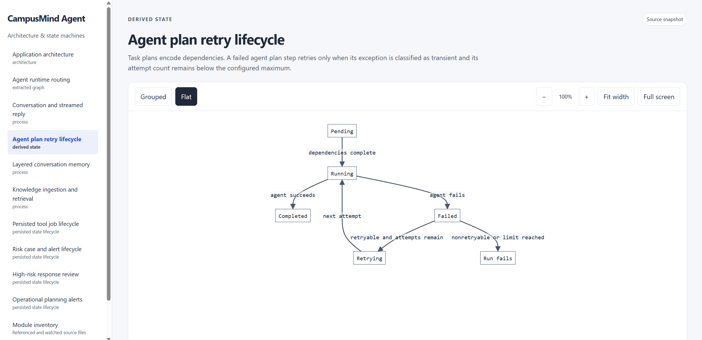
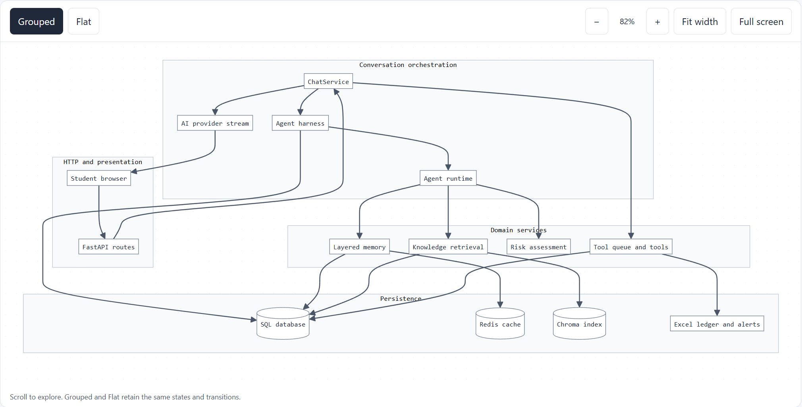
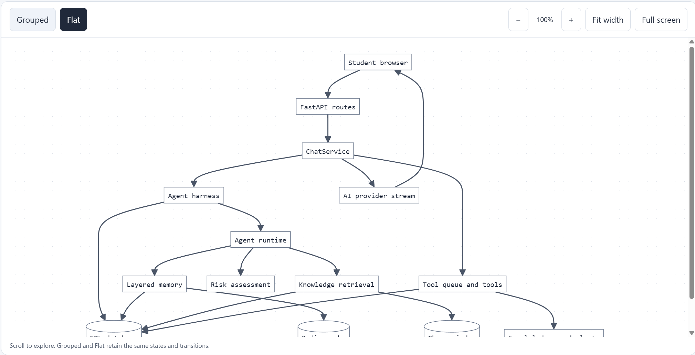

# Architecture and state-machine docs skill

A portable Agent Skill for producing source-grounded architecture maps and state-machine documentation as a standalone HTML explorer. It supports Codex, Claude Code, and Pi through their shared `SKILL.md` format.

The skill guides an agent to inspect a project, map its actual implementation, create grouped and flat diagrams with linked source excerpts, and verify the generated file. It includes a reusable HTML template, a vendored Mermaid renderer, a section schema, a source refresher, and tests for the generic builder.

## Example output

The generated explorer includes module navigation, source-grounded diagrams, grouped and flat views, zoom controls, and expandable source evidence.

The same architecture diagram can be viewed grouped by ownership or as a flat graph.

## Install

Clone this repository into the skill directory for your agent:

| Agent | User-level skill directory | Explicit invocation |
| --- | --- | --- |
| Codex | `~/.codex/skills/state-machine-docs` | `$state-machine-docs` |
| Claude Code | `~/.claude/skills/state-machine-docs` | `/state-machine-docs` |
| Pi | `~/.pi/agent/skills/state-machine-docs` | `/skill:state-machine-docs` |

For project-only installation, use `.agents/skills/state-machine-docs` with Codex and Pi, or `.claude/skills/state-machine-docs` with Claude Code. Claude Code requires the skill directory to be directly under `.claude/skills/`.

The skill is explicit-invocation-only. Claude Code and Pi read `disable-model-invocation: true` from `SKILL.md`. Codex reads `policy.allow_implicit_invocation: false` from `agents/openai.yaml`. The Codex metadata file is optional and can be ignored by other agents.

Each agent needs shell access and Python to run the included builder. Verify every grouped and flat diagram with the host's browser automation tool or equivalent browser checks. If browser verification is unavailable, report that limitation instead of claiming the diagrams were verified.

## Project output

The skill generates `docs/architecture/index.html`, `index.md`, and `revision.json` in the target project. Run `python scripts/build_architecture_docs.py` in that project to regenerate the explorer, followed by `python scripts/build_architecture_docs.py --check` to check source freshness.

The generated explorer is a source snapshot. It does not observe a running application.

Exploration follows implementation components into their decisions, collaborators, state changes and failure paths. Meaningful modules get sidebar detail views. The manifest's `coverage` records link discovered components to those views or explain exclusions; an overview or file inventory alone does not establish coverage.

The browser verifier rejects invalid diagrams, rendering failures and differences in nodes, connections or labels between grouped and flat views. Existing projects need the updated generator and template, plus a source-reviewed `coverage` list, before regeneration. See [the section schema](references/sections.md).

## Verify the bundled builder

Run `python scripts/test_build_docs.py` from the skill directory.

## Third-party asset

The Mermaid renderer in `assets/mermaid.min.js` is distributed under its own license, included in `assets/mermaid-LICENSE`. Keep that license with the renderer.
